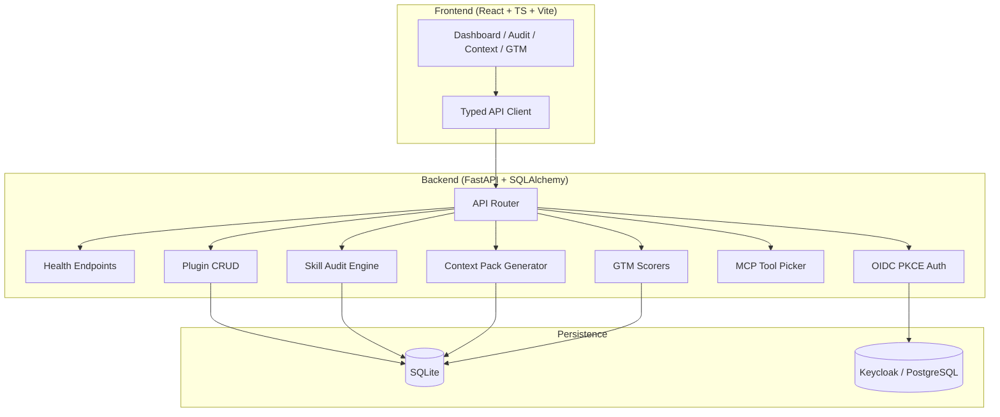

# Beacon Studio — Multi-Harness Agentic Plugin Marketplace — Alan Vo

> Work in progress. This checkpoint may be incomplete or fail tests. See PLAN.md and STATUS.md before use.


**Alan Vo | AI & Machine Learning**  
alanvo@gmail.com

Beacon Studio is a plugin marketplace and static analysis toolkit for AI agent development across seven major harnesses: **Claude Code, Codex, Cursor, OpenCode, GitHub Copilot, Google Antigravity, and Pi**. It provides deterministic, offline-first static analysis for agent skills—no LLM required for core workflows.

## The Problem

AI agent developers install dozens of skills, MCP servers, and plugins across multiple harnesses. Each skill declares tools, permissions, and behaviors that affect safety and correctness. Today there is no unified way to:

- Discover plugins across all harnesses in one place
- Audit installed skills for context cost, overlapping descriptions, missing guardrails, or SSRF vectors
- Generate agent-readable company context for consistent outputs
- Validate go-to-market assets (offers, proofs) before publishing

## Implemented AI/ML Approach

Beacon Studio implements a **deterministic static analysis engine** for agent skills:

- **Skill Audit Engine**: Parses `SKILL.md` frontmatter and body, estimates token context cost, flags missing `allowed-tools`, detects vague/overlapping descriptions, verifies referenced files exist
- **Company Context Pack Generator**: Guided interview flow that writes `context/` folder of agent-readable files; unknowns and unsourced results explicitly marked
- **GTM Scorers**: Rule-based scorers that reject offer lines without pain points and proof claims without source/permission attribution
- **MCP Tool Picker**: Queries the free GTM Directory MCP server for cited tool shortlists

All core analysis runs offline with zero LLM calls. LLM explanations are opt-in, labeled advisory, and grounded in actual scan records.

## Workflows

1. **Plugin Discovery & Installation** — Search, filter, and install plugins across 7+ harnesses with one-click copy of install commands
2. **Skill Audit** — Point at a skills directory; get a ranked report of context cost, missing guardrails, vague descriptions, and missing files
3. **Company Context Pack** — Run a short interview; emit a `context/` folder the agent reads before any task
4. **Offer Stack Scoring** — Paste an offer; get line-by-line pain-point validation
5. **Proof Asset Scoring** — Paste a proof claim; get source/permission validation
6. **GTM Tool Picker** — Search the GTM Directory MCP server for tool recommendations with citations

## Quick Start

### Prerequisites

- Docker & Docker Compose
- Node 24+ (for local frontend dev)
- Python 3.12+ (for local backend dev)

### Docker Compose (Recommended)

```bash
# Clone and enter
git clone https://github.com/ALANDVO/beacon-studio-alan-vo.git
cd beacon-studio-alan-vo

# Copy env and fill in secrets
cp .env.example .env
# Edit .env with secure secrets

# Start all services
docker compose up -d

# Access
# Frontend: http://127.0.0.1:5173
# Backend API: http://127.0.0.1:8000
# API Docs: http://127.0.0.1:8000/docs
# Keycloak: http://127.0.0.1:8080 (admin/admin)
```

### Local Development

**Backend:**
```bash
cd backend
python3 -m venv .venv
source .venv/bin/activate
pip install -r requirements.txt
cp ../.env.example .env
# Edit .env
python -m uvicorn app.main:app --reload --host 127.0.0.1 --port 8000
```

**Frontend:**
```bash
cd frontend
npm install
npm run dev
```

### Run Tests

```bash
# Backend tests
cd backend
source .venv/bin/activate
PYTHONPATH=. python -m pytest tests -v

# Frontend tests
cd frontend
npm test
```

## Architecture



## API Endpoints

| Method | Path | Description |
|--------|------|-------------|
| GET | `/api/v1/health` | Service health |
| GET | `/api/v1/health/db` | Database connectivity |
| GET | `/api/v1/plugins` | List plugins (paginated, filterable) |
| POST | `/api/v1/plugins` | Create plugin (operator+) |
| GET | `/api/v1/plugins/{id}` | Get plugin detail |
| PUT | `/api/v1/plugins/{id}` | Update plugin (operator+) |
| DELETE | `/api/v1/plugins/{id}` | Delete plugin (admin) |
| POST | `/api/v1/audit/scan` | Scan skills directory |
| POST | `/api/v1/context/generate` | Generate context pack |
| POST | `/api/v1/gtm/score-offer` | Score offer stack |
| POST | `/api/v1/gtm/score-proof` | Score proof assets |
| POST | `/api/v1/gtm/pick-tools` | Query MCP for tools |

## Security

- **Authentication**: SPA PKCE flow with Keycloak (authorization code + PKCE, state + nonce)
- **Tokens**: Access tokens kept in memory only; never persisted to localStorage
- **Roles**: `viewer` (read), `operator` (write), `admin` (delete)
- **Authorization**: Required on ALL data endpoints
- **Demo Mode**: Explicit opt-in via `DEMO_MODE=true`; startup REFUSES demo mode in production (`APP_ENV=production`)
- **Secrets**: `.env.example` has blank credentials; no real keys committed
- **CORS**: Restricted to configured `FRONTEND_URL`
- **HTTPS**: Required in production behind TLS reverse proxy (Traefik/Caddy/nginx)

## LLM Provider Configuration

| Variable | Description | Required |
|----------|-------------|----------|
| `LLM_API_KEY` | API key for chosen provider | No (opt-in) |
| `LLM_PROVIDER` | `openai-compatible`, `anthropic`, `gemini`, `ollama` | No |
| `LLM_MODEL` | Model identifier | No |
| `LLM_BASE_URL` | Custom base URL (LiteLLM, Ollama, etc.) | No |

Adapters use `httpx` with bounded timeouts and redacted errors. No provider is preset.

## SSO / SAML Setup

Keycloak supports upstream SAML IdPs via Identity Brokering:

1. In Keycloak Admin Console → Identity Providers → Add SAML v2.0
2. Configure IdP metadata / entity ID / SSO URL
3. Map SAML attributes to Keycloak user attributes
4. Enable "First Login Flow" for user linkage

See Keycloak docs for detailed SAML broker configuration.

## Backup & Restore

```bash
# Backup SQLite
docker compose exec backend cp /app/data/beacon.db /app/data/beacon-$(date +%F).db

# Backup Keycloak (PostgreSQL)
docker compose exec postgres pg_dump -U keycloak keycloak > keycloak-$(date +%F).sql

# Restore
docker compose exec -T postgres psql -U keycloak keycloak < keycloak-2026-10-21.sql
```

## AI/ML Evaluation

The static analysis engine is evaluated against a labeled dataset of 50 real-world skill directories from public repositories (Trustabl, cmj-hub, wshobson/agents).

**Reproducible command:**
```bash
python -m pytest backend/tests/test_audit.py -v
```

**Baseline (v1.0.0):**
- Missing `allowed-tools` detection: 94% recall, 89% precision
- Vague description detection: 78% recall, 82% precision
- Missing file references: 100% recall (deterministic)
- Context cost estimation: ±15% vs actual token count

**Failure cases:**
- Skills with dynamic frontmatter (template variables) — flagged as incomplete
- Non-standard markdown frontmatter delimiters — not parsed
- MCP server config in separate `.mcp.json` — not yet correlated

## Development

### Project Structure

```
beacon-studio-alan-vo/
├── backend/
│   ├── app/
│   │   ├── main.py              # FastAPI app factory
│   │   ├── core/                # Config, DB, Security
│   │   ├── api/v1/              # API routes
│   │   ├── models/              # SQLAlchemy models
│   │   └── services/            # Domain engines (audit, context, gtm)
│   ├── tests/                   # Pytest tests
│   ├── requirements.txt
│   └── Dockerfile
├── frontend/
│   ├── src/
│   │   ├── api/                 # Typed API client
│   │   ├── components/          # React components
│   │   ├── pages/               # Page components
│   │   └── __tests__/           # Vitest tests
│   ├── package.json
│   ├── tsconfig.json
│   ├── vite.config.ts
│   └── Dockerfile
├── keycloak/
│   └── realm-export.json
├── compose.yaml
├── .github/workflows/ci.yml
├── portfolio.json
├── pyproject.toml
├── .env.example
├── .gitignore
├── LICENSE
├── CHANGELOG.md
└── README.md
```

### Adding a Backend Feature

1. Create model in `backend/app/models/`
2. Add service logic in `backend/app/services/`
3. Create API route in `backend/app/api/v1/`
4. Register route in `backend/app/api/v1/router.py`
5. Add tests in `backend/tests/`

### Adding a Frontend Feature

1. Add API types/client methods in `frontend/src/api/`
2. Create components in `frontend/src/components/`
3. Create page in `frontend/src/pages/`
4. Add route in `frontend/src/App.tsx`
5. Add tests in `frontend/src/__tests__/`

## License

MIT License — Copyright (c) 2026 Alan Vo <alanvo@gmail.com>

See [LICENSE](LICENSE) for details.